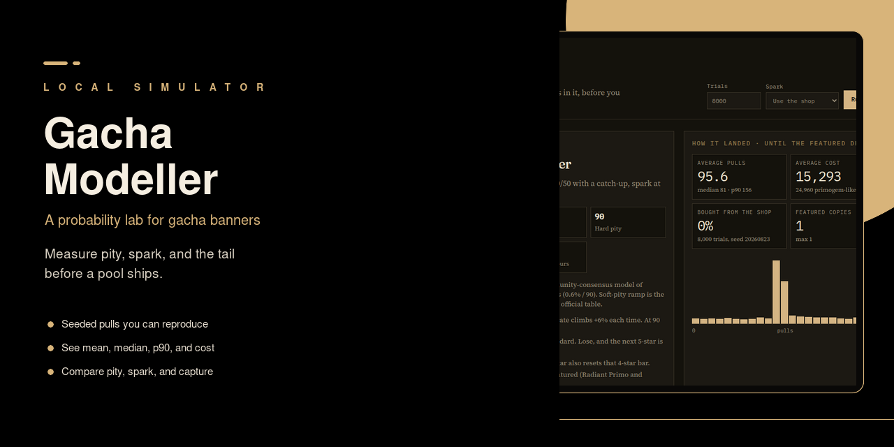

<!-- markdownlint-disable MD033 -->

<div align="center">

  <h1>Gacha Modeller</h1>

  <p>Probability mechanics, economy scenarios and baseline/candidate analysis.</p>

  <p>
    <a href="#analysis-capabilities"></a>
    <a href="./package.json"></a>
    <a href="https://github.com/apoapostolov/Gacha-Modeller/releases/latest"></a>
    <a href="https://github.com/apoapostolov/Gacha-Modeller/releases/latest"></a>
    <a href="./LICENSE"></a>
  </p>

</div>



Gacha Modeller is a local analysis workbench for banner, lootbox and digital-pack models. Immutable baseline/candidate snapshots support reproducible comparisons of acquisition distributions, resource consumption and calendar-based cash contribution. Completion, subjective reward utility and assumed activity remain distinct outcomes.

## Analysis capabilities

The [company workbench guide](docs/company-workbench.md) describes model authoring, imports, comparison and replay. The [development checklist](DEVELOPMENT.md) tracks delivery and external evidence gates. The [M4 contract](docs/milestone-4.md) covers mathematical analysis; the [M5 contract](docs/milestone-5.md) covers financial conventions and synthetic economy scenarios.

- **Acquisition mechanics:** rarity priority, hard/soft pity, featured and selected-target protection, exchanges and scoped progress.
- **Pack and duplicate rules:** slot quantities, distinct-item sampling, shared-item packs, copy caps, salvage and crafting.
- **Probability distributions:** completion, mean consumption, population attainment percentiles, incomplete pursuits and common-axis curves.
- **Mathematical checks:** supported exact solvers, explicit fallbacks, sampling intervals and paired differences.
- **Player groups and parameter experiments:** declared starting progress, fixed population shares, bounded grids and validation seeds.
- **Economy and calendar scenarios:** origin-separated wallets, cash payments, offers, subscriptions, grants, refunds, availability and season migrations.
- **Policy and utility assumptions:** non-paying, budget-limited, goal-oriented and saving populations; hard affordability/time limits; item upgrade curves and roster coverage.
- **Sensitivity and evidence:** D7/D30/D90 and season-end outcomes, no-response and adverse cases, portfolio displacement and reconciled synthetic pilot fixtures.
- **Audit and replay:** source-labelled mechanics, individual trial journeys, complete aggregate ledgers and versioned project/comparison exports.
- **Directory project library:** runtime section folders, validated project files, conflict-aware saves and browser-project migration.
- **Company evidence:** editable synthetic/CSV extracts, training and holdout estimates, assignment checks, group uncertainty, tail sensitivity and hashed decision records. See the [M6 contract](docs/milestone-6.md).
- **Specialist financial profiles:** lifetime collectible supply, assumed resale liquidity, fees, market-value cases and redemption obligations; static payout RTP/volatility, player outcomes and treasury portfolios. See [M7 research and acceptance](docs/milestone-7.md).
- **Catalogue integration:** reviewed local PlayFab/Unity/customer identity subsets, explicit name mappings and hashed review exports. Scoped operational/legal/test-house declarations detect changed configurations; exports remain research-only.

## Catalog

Studied presets follow a published or community-consensus shape. They are not licensed live tables.

| Preset | Shape |
| --- | --- |
| Genshin-like Character | 0.6% / 90, soft ramp from 74, 50/50 capturing, spark 180 |
| Blue Archive-like Spark | 0.7% pickup, 200-point spark, leftover bar survives a natural hit |
| Blue Archive-like Charge | JP 5.5: 100 = 50% pickup 3-star, 200 = pickup, hit resets |
| FGO-like Story Banner | 1% SSR, 80% on the rate-up, featured pity at 330 |
| Independent Crate | 0.64% covert, no pity |
| 1% + Hard Pity 100 | Teaching control |
| Overwatch-like legendary cosmetic box | Four rewards, a legendary slot and a synthetic cosmetic collection |
| Fortnite-like revealed X-Ray llama | Fixed known Save the World offer using earned tickets |
| Fortnite-like historical blind llama | Synthetic random-pack contrast to the revealed offer |
| Example collectible card pack | A fictional card pack with a rare floor, duplicate shards and missing-card crafting |

Pool Share, Collection Heat and Audience Spark are original models. Engine semantics are documented in [the methodology](docs/methodology.md); Blue Archive-like charge and spark shapes are described in [the recruitment study](docs/blue-archive-recruitment.md).

## Local development

```bash
cd Gacha-Modeller
npm install
npm test
npm run dev
```

The development server runs at http://127.0.0.1:3018/. A fixed seed, immutable models, settings and engine version reproduce the same result. The [synthetic economy fixture](docs/fixtures/company-economy.json) provides a complete Milestone 5 example.

Rendered UI checks use lintapple and the project design rules in `ui-policy.json`. With the development server running, `npm run lint:ui:page` checks the initial view, and `npm run lint:ui` checks 54 rendered states across phone, tablet and desktop widths, including game descriptions and sources, completed baseline analyses, comparisons, company evidence and specialist settings. The checks do not save drafts or edit project files. On a new machine, install Chromium with `npx playwright install chromium --only-shell`.

`npm run lint:ui -- --report output/playwright/ui-report.json --screenshots output/playwright/screenshots` retains a JSON report and captures. Exit 1 includes unresolved contrast measurements in overlapping help panels and partially visible drawer content; these require visual review and are not reported as passes. The UI uses local system fonts, explicit control spacing, tabular figures and HTML chart axes that retain their text size on narrow screens.

Sections are subfolders of `projects/`, each with `section.json` and complete project JSON files. Refresh library discovers new files without a build. The Company section contains editable synthetic assumptions and evidence. Existing browser projects can be migrated to Workspace; their original bytes remain available. Workspace files are ignored by Git by default.

The sidebar separates Projects and Companies, with instant search that opens matching folders. Projects open with current rules, a full game-and-reward overview and a results table. **Simulate current rules** fills the current-model results; **Load proposal** selects the latest or an earlier candidate, and **Compare rule sets** adds the proposed-model and change columns. Removing a proposal keeps the current-model results from the last completed run. Earlier proposals do not replace the current saved candidate. Format 7 supports editable game, reception, business and source descriptions without changing model hashes. The [workspace usability contract](docs/workspace-usability.md) records these flows and accessibility decisions.

The Specialist studies section contains editable collectible and payout projects; Catalogue integrations contains a synthetic PlayFab mapping example. Modules can be attached to other projects. Profile settings retain the financial baseline and edit the candidate. Complete JSON supports additional supply rows or payout outcomes. Their hashes and cash contracts are independent from the acquisition snapshots. Catalogue integration maps names without guessing drop probabilities or cash values.

`npm run build` then `npm start` serves the built app with the same local directory API. `npm run project:create -- --input <model-or-project.json> --section workspace` creates a validated file; `npm run project:create -- --validate` checks the directory. The [reward-project-authoring skill](skills/reward-project-authoring/SKILL.md) covers new sections and game profiles. Node 22.23 or newer is required for the local TypeScript scripts.

## Limits

- Local-only storage, with no accounts, telemetry or live game configuration feeds.
- Economy outputs use synthetic assumptions. Company finance/data approval, real behavioural calibration and a repeated commercial decision remain pending.
- Company extracts currently use independent group-period aggregates. Per-item production-state adapters, immutable approval/preregistration and automatic identity stitching remain outside this local implementation.
- Named game examples cover their documented subset. Overwatch regular-box counters and Fortnite revealed-offer choice policies are not implemented by the shipped examples.
- Calendar economy contribution excludes statutory revenue recognition, fixed costs, discounting and cash-out liabilities. Specialist profiles separately declare period costs and redemption promises under their bounded contracts.
- Specialist profiles are synthetic research, with static payouts and assumed market values. Hosted identity/compute, authenticated approval, customer integration review and jurisdiction/test-house acceptance remain pending. Unity's adapter targets existing Economy configurations after the September 2026 new-sign-up closure.
- Calendar events operate on local civil days; intraday sessions, automatic churn and causal engagement models are outside the current contract.
- Exact analysis supports bounded model shapes; other cases use simulation with an explicit explanation.

## License

MIT. Copyright 2026 Apostol Apostolov.
