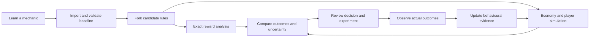

# Gacha Modeller: company product blueprint

Prepared 10 October 2026. Status: researched proposal, ready to scope into implementation. No commercial engine or deployment has been implemented by this planning work.

Read alongside the [research foundation](company-research.md) and [implementation backlog](company-implementation-backlog.md). Citations and access limitations live in the research document; model equations, schemas and product recommendations below are original design proposals.

## 1. Product direction and first customer

Build a **reward economy design and evaluation workspace**. A company should be able to explain an existing reward model, modify it without rewriting simulation code, compare the result across player and business outcomes, and carry a reviewable candidate into an experiment.

The first product should serve an economy designer and an analyst working on a closed-loop collection game or digital-pack product. Finance and live operations review the output. This is the shortest route from the current engine to a credible business tool. Transferable collectibles and licensed cash gambling require additional economic and operational modules; develop those as explicit profiles with their own acceptance criteria.

The product promise is: **Understand what your rules do, see who benefits or loses, and identify the evidence needed to improve long-term contribution.**

Learning, customization, comparison and evidence must form one continuous workflow. A preset library alone is a tutorial. A simulation chart alone is an analysis fragment. A company needs a saved decision record linking rules, assumptions, results and subsequent observed performance.

### First successful company session

1. Import the current banner or pack configuration and an initial player-state distribution.
2. Review an executable explanation of its probability and reset rules.
3. Reproduce a known production outcome distribution or authoritative reference calculation.
4. Fork the baseline; change two declared rules, such as a target guarantee and duplicate salvage.
5. Compare identical starting populations, horizons, prices and content calendars.
6. Inspect reward access, dissatisfaction proxies, virtual-currency balance and contribution scenarios.
7. Export a recommendation that identifies facts, assumptions, uncertainty, eligibility checks and an experiment design.

**Proposed usability target:** an experienced designer completes a prepared-fixture version in under 30 minutes without touching code. Real data mapping may take longer and should be measured separately.

## 2. Audit of the existing repository

Audit basis: working tree at commit `fc8b2bca02ce54a7b98001a4906553cadca9b1b8`, including existing uncommitted edits. The app is Vite/React/TypeScript, with a pure TypeScript engine. Existing tests: 22 passing. TypeScript check: passing. These checks verify the current test contract, not readiness for commercial decisions.

### Assets worth retaining

- Separation of `src/engine/`, data presets and React UI.
- Explicit seeded RNG and small state-machine functions.
- Hard/soft rarity pity, featured capture, spark and charge checkpoints.
- Multiple stop goals in the engine, including copies and collection completion.
- Mean, quantiles and histogram summaries.
- Experiments with shared pity, missing-item weighting and audience spark.
- Tests pinning several mechanical invariants and broad distribution windows.

### Gaps that determine the plan

| Finding | Evidence | Consequence and proposed change |
| --- | --- | --- |
| No user-authored model workflow | `App.tsx` selects static presets; controls cover trials and spark policy | Introduce saved model versions, import/export, validation and a form-based editor. |
| Pack guarantee is metadata only | `guaranteeRarity` occurs in types/presets, never in engine resolution | Add an actual pack executor. A ten-pack is not equivalent to ten independent pulls if it promises a guaranteed slot. |
| Cost is nominal consumption | `runTrial` multiplies pulls by `pullCost.amount` | Add wallets, cash purchases, free grants, bundles and explicit costs before reporting money or margin. |
| Silent horizon termination | `HARD_CAP = 100000`; returned trial has no success/status flag | Report completed, horizon-ended, budget-ended, impossible and invalid cases separately. |
| Exchange and draw share resets | `sparkIfReady` calls `grantFeatured`, which changes rarity counters and capture | Make reset effects explicit by event type; a shop purchase should do only what the model declares. |
| Rates rely on array order | Highest-first hard-pity precedence and cumulative effective rarity rates | Validate probability mass and declare conflicts/priority. Do not let order silently truncate a lower tier. |
| Guarantee choice is implicit | `nextFeaturedItem` selects first missing, then first pool item | Separate random grant, target-specific guarantee and player-selected exchange. Validate feasibility of target sets. |
| Simulation blocks the UI | `setTimeout` delays synchronous `runMonteCarlo`; it does not move computation off thread | Run jobs in workers with cancellation, progress and stale-result protection. |
| Sample tape is not reproducible with report seed | `runTape` uses a `Date.now()`-derived seed | Persist preview seed and initial state in saved runs. |
| Comparative runs are not formally paired | Sequential stream consumption; same seed does not align every event across variants | Version a random-stream contract and report paired or independent comparisons correctly. |
| Statistics have no uncertainty or completion denominator | Current summaries include all returned trial lengths | Add success-within-budget/time, censored analysis and uncertainty appropriate to each estimator. |
| Scalability is unbenchmarked | Results/inventories retained per trial; histogram spreads arrays into `Math.max` | Compile pools, aggregate incrementally, retain sampled traces and benchmark event counts/memory. |
| Social result is narrow | `simulatePoolShare` compares fixed budgets from fresh states | Treat it as a boundary-condition experiment; add allocation, persistence and group context before general claims. |
| Presets lack structured provenance | `source` is prose; official, inferred and synthetic elements can be mixed | Track evidence per mechanic, date, region and patch; display synthetic additions separately. |

Three focused read-only probes confirmed that an impossible target returns 100,000 pulls with zero featured items; a 100,001-pull budget stops at 100,000; and a ten-pull model declaring a rare guarantee can return ten filler items. Another probe confirmed that a spark exchange clears the rare counter, armed capture and featured-since counter. That last behaviour is a model semantics issue requiring explicit choice, not proof that every preset currently produces a wrong first-target mean.

The Genshin-like preset includes a synthetic spark overlay and a community soft-pity approximation. The company tool should label those separately from official rates. The FGO-like model combines a recurring featured cap and spark; repeated-copy analyses need verification of the intended like-model rather than assuming live-game parity. Do not base commercial decisions on names alone.

The current charter specifies local-only operation. Preserve that during the first commercial modelling pilot. Hosted accounts, shared databases, telemetry ingestion and deployment adapters are proposed later capabilities that require an explicit charter revision at implementation time.

## 3. Conceptual model

Use five independent layers. Changing an assumption in one layer must not silently change the others.

| Layer | Describes | Examples |
| --- | --- | --- |
| Reward mechanics | What an eligible action grants | Drop tables, pack slots, pity, capture, duplication, exchange |
| Economy | What actions cost and how resources flow | Paid/earned currency, store bundles, salvage, subscriptions, payouts |
| Player policy | What a simulated player chooses | Save for a target, stop at budget, buy a pack, switch banner, take a break |
| Calendar/context | What is available and when | Sessions, event cadence, roster changes, progression needs, season transitions |
| Evaluation | What counts as improvement | Contribution, attainable goals, reported enjoyment, retention, robustness |



### Evidence labels

Every report metric has one of these labels, plus its data/version references:

- **Exact under these rules:** enumerated or analytically calculated probability.
- **Monte Carlo estimate:** finite-sample estimate of declared mechanics.
- **Assumed behaviour:** synthetic policies and user-entered response parameters.
- **Calibrated forecast:** fitted to company data, with validation and applicability limits.
- **Observed outcome:** descriptive production or experimental data.
- **Experimental effect:** effect estimate from a valid comparison design, with uncertainty.

An observed metric is not automatically a causal effect. A million simulated players do not turn assumed behaviour into observed evidence.

## 4. Model learning and customization

### The model library should teach mechanisms

Start with a mechanism atlas: independent draw, hard cap, soft-pity hazard, capture after a miss, target-specific pity, point exchange, checkpoint charge, missing-item protection, fixed-slot pack, no-replacement pack and deterministic purchase.

Each teaching card includes a rules diagram, editable example, conditional odds by state, worked journey, acquisition curve, expensive tail, interactions, evidence source and limitations. Let users step through a miss, a hit, a switch and an exchange. Show which state changed and why.

Make original presets copyable starting points. Retain like-model naming. Provide a synthetic/official/community label per rule; link to the inspected source and specify region/date. A company can then replace example rules with its own authoritative configuration.

### Customization matrix

| Domain | Parameters users can edit | Required semantics and validation |
| --- | --- | --- |
| Item catalogue | Stable IDs, tags, rarity, category, quantity, availability, target eligibility | Validate IDs and references; distinguish rarity from utility and cost. |
| Drop selection | Absolute probabilities, within-tier weights, conditional pools, replacement mode | Require a declared selection scheme; show final item probabilities. |
| Pity | Base hazard, hard cap, piecewise/table/linear/logistic ramp, tier interactions | Define whether counters count attempts or failures; check all reachable-state probabilities. |
| Featured/target rules | Rate-up chance, capture, target selection, path points, once-only guarantee | Distinguish any featured item from the selected item and first copy from upgrade copies. |
| Reset/persistence | Reset on natural hit, forced hit, exchange, switch, season end; scoped carryover | Explicit counter scopes: player, banner family, banner, item, group, season. |
| Pack layout | Slot count, per-slot pools, quantities, at-least-one guarantee, reroll/replacement rule | Declare resolution order and whether a guarantee replaces a slot or adds an item. |
| Correlation | Exclusive slots, shared rarity choice, no replacement, batch-level rules | Compute pack odds from the joint process, not by multiplying marginals blindly. |
| Duplicate treatment | Copy cap, salvage amount, craft currency, replacement, protection weighting | Specify surplus handling, eligibility and exchange ratios; preserve ledger conservation. |
| Exchanges/crafting | Selectable catalogue, costs, limits, rollover and conversion | Define redemption policy and item choice; separate grants from pull-counter resets. |
| Starting state | Inventory, wallets, counters, target history, prior guarantees and progress | Allow distributions for cohorts and imported snapshots; do not restart every incumbent at zero. |
| Prices/offers | Single/batch price, bundles, bonuses, subscription, purchase limits, direct purchase | Track real cash independently of nominal currency consumption. |
| Free rewards | Login/quest grants, attendance assumptions, event compensation, milestones | Tag paid, earned and promotional balances; declare consumption order and expiry. |
| Game utility | Cosmetic preference, roster coverage, synergy, upgrade curve, progression gates | User-entered or calibrated utility function; never present subjective units as currency. |
| Content cadence | Banner calendar, overlapping offers, reruns, catalogue growth, rotations | Declare availability and migration; detect unresolved goals after rotation. |
| Player choices | Pull/save/switch/buy/stop/craft/direct-buy policies | Hard budget and time constraints dominate choice; distinguish scripted from fitted decisions. |
| Social systems | Contributions, claim allocation, group formation/exit, visibility, sponsor subsidy | Account for ownership and group-level uncertainty; avoid counting one reward for every member. |
| Collectible markets | Mint supply, transferability, fees, redemption, buyback, price/liquidity scenarios | Separate market value from guaranteed redemption and operator liability. |
| Gambling | Paytable, stake, bonus states, payout caps, progressive funding, reserve scenario | Dedicated eligibility review; calculate theoretical and realized payout distributions. |

### Extension contract

Begin with forms and a typed declarative rule format. Users combine supported modules and conditions; they should not need a general programming language for common changes. An advanced view shows the exact versioned JSON and a semantic diff.

For custom company mechanics, provide vetted engine plugins with a contract containing state dependencies, eligibility, outcome distribution, transition, ledger effects, explanation and solver support. An analysis-only plugin can run via Monte Carlo when an exact solver is unavailable; its report must say so.

Do not execute arbitrary imported JavaScript in the browser. Expressions must use a bounded, typed AST and an allowlist of operations. Future private plugins run in isolated jobs with explicit versions, resource limits, deterministic inputs and tests. A diagram editor can compile to the same rule format later; it should not define a second set of probability semantics.

### Resolution sequence

Compile one authoritative sequence used by simulation, explanation and disclosure:

1. Resolve offer/version, eligibility, target and starting state.
2. Determine payable action price and atomically debit the appropriate balance.
3. Apply pre-action conditions and guaranteed outcomes using declared precedence.
4. Resolve pack slots/draws and any pack-level constraints.
5. Resolve target/featured selection and item quantities.
6. Apply ownership, duplication, salvage and utility changes.
7. Update counters and points according to the actual event type.
8. Apply optional exchange decisions as separate ledger events.
9. Emit trace, ledger and metrics; evaluate stopping conditions.

Rejected actions do not spend currency or advance counters. Define whether an atomic ten-pack must finish and be charged in full when a target lands in slot two; distinguish its *target slot index* from the *number of items purchased*. This matters to cash comparisons.

## 5. Analysis that answers a designer's questions

### Probability views

Provide PMF, CDF, survival and conditional next-action odds. Include target acquisition within a pull/cash/time budget, multiple-copy attainment, set completion, duplicate counts and unused protection progress. Show expected value alongside p50, p90, p95 and p99, plus probability of failure within the horizon.

Let users inspect cold-start, existing pity, armed capture, advanced collection, and several simultaneous targets. Conditioning must be visible: comparing each model's own early winners can describe different selected populations and should not be presented as a paired causal comparison.

For independent per-pull target probability `p`, with a guaranteed target at pull `H`:

```text
P(T > n) = (1-p)^n                    for 0 <= n < H
P(T = n) = (1-p)^(n-1) p             for 1 <= n < H
P(T = H) = (1-p)^(H-1)
E[T] = sum(n=0..H-1) (1-p)^n = [1-(1-p)^H]/p
```

For `p=0`, the declared hard guarantee gives `T=H`; without a guarantee the goal may be impossible. For a stateful model, construct transitions over the necessary counters, capture, ownership and target state. Use dynamic programming or absorbing-chain methods within a measured state-space limit. Report approximations or Monte Carlo fallback when collection combinations make exact enumeration impractical.

Check pack calculations independently. Five independent slots with 2% rare chance have `1-0.98^5 = 9.6079%` probability of at least one rare, not 10%. A guaranteed rare changes the joint distribution and how other slots work. Ten equally weighted distinct collectible items sampled with replacement take `10 * H_10 = 29.2897` individual item draws on average to complete, under those exact assumptions; do not label this as packs unless a pack contains one such draw.

### Statistical integrity

Always return `terminationReason`, `goalAchieved`, `goalAchievedAt`, horizon, budget and invalid-state diagnostics. A run stopped at 10,000 pulls is not a success at 10,000 pulls. Show attainment probability and remaining failure mass; an acquisition quantile beyond the horizon is unavailable or greater than horizon, not zero or the cap.

Separate three uncertainties: finite Monte Carlo error, uncertainty in fitted/entered behavioural parameters, and structural uncertainty about the player policy or economy. Plot scenario bands separately from sampling confidence intervals. For rare outcomes, use exact calculations where possible or documented specialized estimators; zero simulated hits is not zero probability.

Use stable random draws keyed by trial/entity/event namespace, with independent streams for reward, attendance and choice. Record the RNG algorithm and scheme version. Pair comparable exogenous events across variants when possible; measure whether pairing reduces variance. Different designs can produce diverging paths, so shared seed alone is insufficient and variance reduction is not guaranteed.

Bootstrap comparative results at the independent unit, such as player or group. Revenue is often concentrated: show raw means, distribution, top-share concentration and sensitivity to a few large observations; keep any robust/transformed analysis supplementary and clearly labelled.

### Explanatory traces

Save representative journeys: lucky, median, unlucky, budget-ended, duplicate-heavy and group-conflict cases. A trace shows conditional odds, selection draw, chosen rule, item utility, cash/currency changes and reset events. Generate an explanation from the rule executor. Avoid storytelling that substitutes for the actual trace.

## 6. Profitability, rewards and engagement across time

### Separate the dimensions

Money is a financial outcome. Engagement, excitement, progression and trust are player/product outcomes that can influence future money. The tool should show their relationship and uncertainty, not add minutes, dollars and survey ratings into a fabricated profit score.

| Horizon | Player questions | Business questions | Proposed default views |
| --- | --- | --- | --- |
| Session / D0-D7 | Can I understand the system, receive something useful, and stop within my plan? | Does onboarding create voluntary participation and early value? | First useful reward, target probability within budget, reported enjoyment, D1/D7 return, cash paid and regret |
| D8-D30 / one event cycle | Is collection/progression still meaningful? Do duplicates help? | Are repeat participation and subscription value improving after cannibalization? | D30 return, active days, goal attainment, salvage/crafting flow, repeat purchase, contribution per eligible player |
| D31-D90 / several cycles | Do prior rewards remain useful? Can I pursue new goals without losing progress? | Does contribution hold after novelty, refunds and content expense? | D90 contribution, target-switch journeys, currency balance, trust/complaints, retained participation |
| D91-D365 / multi-season | Does the game stay enjoyable after completion and roster growth? | Are contribution, acquisition payback and economic stability sustainable? | Mature-cohort actuals, explicit extrapolation, supply/liquidity scenarios, content cadence and marginal campaign ROI |

These are editable analysis windows. A seven-day pack event and a quarterly season need different windows. Avoid claiming year-long results from a short observed period.

### Metric definitions

| Dimension | Metrics | Interpretation limits |
| --- | --- | --- |
| Reward access | P(target by budget/day), first useful reward time, copies/collection milestones | Mechanically calculable only with defined action/calendar policy. |
| Reward quality | New usable items, upgrade utility, roster coverage, redundant duplicates | Utility requires a game-specific value model. |
| Reward pacing | Gap distribution between meaningful rewards, milestone spacing, completion runway | Pacing is a proxy; it is not measured happiness. |
| Excitement/enjoyment | Post-session self-report, perceived surprise/value, replay/skip preference | Validate through playtests or surveys; entropy and variance are mechanical descriptors only. |
| Agency/trust | Odds comprehension, perceived fairness, confidence in costs, satisfactory stopping | Measure directly; predict only after calibration. |
| Engagement | Active days, voluntary return, non-purchase play, event participation, item usage | Longer sessions or more pulls can reflect friction or pressure. |
| Finance | Contribution/eligible player, payer conversion, ARPPU, refunds, chargebacks, costs | ARPPU can rise because low-spend players leave; keep population denominator. |
| Economy | Currency sources/sinks, balances, unspent paid amounts, salvage issuance, market supply | Currency burn is not new revenue. |
| Quality/protection | Budget adherence, pressure/regret reports, support issues, eligibility violations | Do not infer clinical diagnoses from spending alone. |

Define D7/D30/D90 point retention as return in the specified day window among an eligible mature starting cohort. Show rolling retention separately. Define all day boundaries, timezone, windows and population filters. For returning incumbents, measure from experiment assignment/event entry and label it accordingly.

### Economy and financial ledgers

Keep two connected but distinct ledgers:

- **Resources:** paid, earned and promotional currency grants/debits; items; exchanges; subscriptions; salvage; expiry; inventory and outstanding redemption obligations.
- **Cash/contribution:** actual payments and operator receipts, refunds/chargebacks, taxes handled according to an agreed convention, platform/payment fees, payouts/fulfilment, variable service/support/fraud costs and attributable promotion costs.

Use integer minor units or fixed-point amounts with explicit scale. Record exchange conversions, dated FX assumptions and whether a price includes tax. Do not subtract a platform fee twice when an imported receipt is already net.

Proposed managerial convention for a closed-loop game:

```text
CM_H = actual customer payments over H
       - tax remitted under the chosen gross-price convention
       - refunds and chargebacks
       - platform/payment fees
       - fulfilment/redemption costs
       - attributable variable service, support and promotional costs

CM per eligible player = sum(CM_H) / all eligible starting players
Net acquisition contribution_H = CM per acquired player_H - acquisition cost per player
```

Fixed content, staffing and licence costs belong in a separate product-profit view with an explicit allocation. Discount multi-period contribution when appropriate. Do not call contribution EBIT or statutory revenue; finance must approve any recognized-revenue treatment for unspent currencies/subscriptions.

For cash gambling, deposits are wallet funding, not game revenue. Track settled stakes and payouts separately. `GGR = settled stakes - settled payouts` under the agreed convention; net contribution then deducts bonuses, taxes, fees and operating costs with an explicit reconciliation. Recycled winnings increase turnover without creating new deposits.

For collectible markets, gross merchandise value is not operator revenue. Model marketplace commissions, primary sales and buyback/redemption obligations separately. An estimated resale price is not an operator cost unless the operator actually bears it.

### Behavioural simulation

Start with transparent policies: free saver, budgeted event buyer, target collector, progression-focused player, and completionist. Treat them as configurable hypotheses, not stereotypes or latent diagnoses. Budget distributions, attendance, goals, existing inventory and content preferences vary within each cohort and can be correlated.

Each simulated period chooses whether to attend, play, claim grants, pursue a target, purchase, save, switch, redeem or stop. Hard cash/time budgets and eligibility rules constrain every decision. Model intermittent inactivity, churn and possible return separately.

After data exists, fit interpretable attendance and purchase models before complex agents. Include player history, content relevance, price, ownership, useful rewards, stale goals and exogenous seasonality. Use temporal holdouts and evaluate predictions by cohort and horizon. The baseline model must reproduce observed sessions, purchases, balances and attainment within agreed tolerances.

Observed associations between reward drought and churn do not identify the effect of changing pity. Parameters governing responses to new mechanics remain scenarios until tested. LLM-generated player stories may help qualitative design discussions, but they should not be the default quantitative evidence for profitability.

## 7. Baseline versus candidate comparison

### Comparison contract

Freeze the baseline version, initial population, eligibility, valuation, prices, calendar, horizon, budgets, seed scheme and metric definitions. Store each changed assumption in a structured diff. Let users intentionally vary a price or content schedule, but identify that as part of the treatment.

Provide three comparison modes:

1. **Mechanics only:** hold actions fixed to isolate outcome distribution changes. A model with the same actions earns the same receipts unless prices, payouts or costs change.
2. **Policy scenarios:** allow declared player choices to respond. Show conservative, central and optimistic responses, including zero behavioural benefit.
3. **Evidence-linked comparison:** use a calibrated forecast or imported experimental effects, with out-of-distribution flags and uncertainty.

The comparison page shows absolute values and differences, population denominators, horizon and evidence label. Aggregate first, then show cohorts with stable weights. Include incumbent states, F2P resource access, collection progress, low budgets, and the expensive tail. A metric improving through a changing mix of players should be visible.

Use a contribution waterfall: participation, purchase mix, number of purchases, price, refunds, fees, reward costs, cannibalization and variable costs. Since interacting factors do not have a unique attribution, label the selected decomposition order or use a documented symmetric method; do not imply its components are causal effects.

### Worked example: a kinder guarantee has an economic hurdle

This is an analytic teaching example, not a production forecast. Assume independent 1% target rolls before a guaranteed target; one target pursued from fresh state; stop immediately at acquisition; every pull costs exactly $1 cash; no free currency, bundles, taxes, payouts or behavioural response.

| Metric | Baseline: cap 100 | Candidate: cap 80 | Evidence |
| --- | ---: | ---: | --- |
| Expected pulls / cash paid per completed target | 63.3968 / $63.3968 | 55.2477 / $55.2477 | Exact |
| Median pulls | 69 | 69 | Exact |
| p90 acquisition pulls | 100 | 80 | Exact |
| Target by pull 20 | 18.2093% | 18.2093% | Exact |
| Target by pull 50 | 39.4994% | 39.4994% | Exact |
| Target by pull 80 | 55.2477% | 100% | Exact |
| Fraction reaching the forced guarantee | 36.9730% | 45.2044% | Exact |
| Expected receipts change with identical pursuit count | Reference | -12.8541% | Exact under cash assumptions |

The candidate leaves median and early acquisition unchanged, shortens the tail, and concentrates more acquisitions at its earlier cap. Higher cap-hit frequency is therefore not by itself worse player experience. Interpret it alongside the cap length and usefulness.

To preserve receipts with unchanged per-pull contribution economics, the number of completed paid pursuits must rise by:

```text
63.3967658727 / 55.2476786236 - 1 = 14.7501%
```

That increase could come from additional voluntary participation or repeat pursuits, but the calculation does not establish that it occurs. With constant multiplicative fees the same ratio applies; fixed per-target costs, bundles, free balances and other purchases change it. A monthly-wallet product can reduce currency consumption without reducing cash receipts in that month, then affect later top-ups.

The product should generate a break-even surface across participation, repeat purchase, refunds and reward costs, including the no-uplift case. It should also show whether an apparently favourable pursuit uplift comes at the expense of subscriptions or next month's event.

### Additional comparison recipes

| Change | Mechanically measurable outcome | Commercial hypothesis to test |
| --- | --- | --- |
| Missing-item weighting | Collection completion and duplicate distribution | More useful packs improve repeat participation without accelerating content exhaustion too far. |
| Duplicate salvage | Craft currency, guaranteed progress and currency supply | Duplicate dissatisfaction falls; crafting does not simply replace every later purchase. |
| Target-selectable exchange | Selected-item attainment and exchange liability | Agency improves value and trust; margin remains viable after direct substitution. |
| Carryover across events | Residual progress retained and next-event access | Return improves after event misses, with stable currency balances. |
| Batch discount/guarantee | Purchased pack size, cost and joint slot outcomes | The offer changes purchase mix without increasing regret or obscuring cash cost. |
| Common-item utility | Useful progress despite rare misses | Enjoyment and non-purchase play improve because ordinary rewards matter. |
| Shared pity | Group outcomes plus recipient allocation | Social participation improves after free-riding, allocation disputes and group exit are included. |
| Deterministic purchase | Certain access at a known cost | Predictability grows the addressable paying audience, with known random-pack substitution. |

For group comparisons, hold total spend and starting states constant and report individual outcomes as well as group totals. Preserve solo counters across sessions when the baseline does. Unused pity at a reporting horizon is retained progress if the rules carry it forward; calling it wasted requires a real expiry/reset condition.

## 8. Professional UX and information architecture

### Workspace objects and navigation

Use Projects with a product profile, Model Library, Model Versions, Economy, Player Policies, Scenario Calendar, Runs, Comparisons, Evidence and Decision Records. Keep tutorials accessible beside company models. A model belongs to a versioned project; a run references immutable versions and a comparison references runs.

| Screen | Main task | Important controls and outputs |
| --- | --- | --- |
| Project overview | Know what decision is being made | Baseline version, open hypothesis, last validated run, missing inputs and decision owner |
| Learn | Understand a mechanic | Step-through state, conditional odds, explanatory chart, worked example and source label |
| Model editor | Reproduce and modify rules | Catalogue/table editor, pity curve, pack slots, counter scopes, reset matrix, validation and advanced JSON |
| Economy | Configure costs/resources | Currency sources/sinks, price/bundle tables, wallets, salvage, cash conventions and liability view |
| Players and calendar | Define realistic starting journeys | Cohort weights, state distributions, attendance/choice policies, budgets, overlapping events and horizons |
| Run setup | Make a reproducible job | Solver eligibility, sample size/error target, seed, compute estimate, trace retention and cancel/progress |
| Compare | Evaluate the proposed change | Frozen baseline, semantic diff, metrics by horizon/cohort, CDF/survival, margin waterfall and break-even |
| Evidence | Test prediction quality | Historical mapping, holdout accuracy, experimental effect import, quality diagnostics and applicability |
| Decision record | Make review and handoff practical | Recommendation, alternatives, uncertainty, constraints, experiment plan, reviewer status and export |

### Editor behaviour

Use basic and advanced controls within the same validated schema. Edit rates as percentages but store exact scaled numbers. Preview both tier odds and selected-item odds. Distinguish `%` from percentage-point increments. Draw hard-pity spikes explicitly rather than smoothing them into a decorative line.

The reset editor is a matrix: events down rows, scoped counters across columns. Clicking a cell explains its effect using a concrete example. Show conflicts such as an armed guarantee coinciding with a checkpoint before a run. Make unsupported rules errors, not silently ignored metadata.

Import CSV/JSON with column mapping, schema version, unit selection, duplicate-ID checks and a dry-run explanation. Export a portable project bundle with model, assumptions, runs and source references. Partial imports should show the missing fields and whether mechanical-only analysis remains possible.

### Comparison layout

Keep the baseline pinned, show up to three candidates, and let users change the displayed cohort/horizon without rerunning cached results where possible. Use consistent chart bins and scales. Provide CDF and survival views in addition to a histogram because tails and attainment are often easier to compare there.

Every business card shows its evidence label and links to assumptions. If a company's economics are absent, show currency consumption and mechanics; display business metrics as unavailable. If behaviour is synthetic, use scenario language and avoid a winner badge implying observed profit.

Charts need keyboard controls, table equivalents, units, labelled thresholds and palettes that remain usable without colour. Large tables need filtering and stable headers. Use practical rounding in displays while retaining full precision in exports. Empty results, impossible goals and cancelled jobs should have specific explanations.

### Reviewable outputs

Export a concise executive report and a full analyst bundle. The executive report includes the decision, baseline/candidate diff, horizon metrics, conservative scenario, principal risks and next evidence step. The analyst bundle includes configuration hashes, engine version, seeds, metric definitions, methods, raw/aggregate results, trace samples, data provenance and known limitations.

## 9. Optimization without hiding the tradeoff

Start with one-parameter sweeps and two-parameter surfaces. Then add bounded multi-objective search. Users select editable parameters, discrete rule families, constraints and objectives before the job begins.

Example objective vector:

```text
maximize expected 90-day contribution per eligible player
maximize useful goal attainment within a declared budget
maximize observed or explicitly modelled voluntary return/enjoyment
minimize reward drought, redundant duplicates and economy instability
```

Choose limits such as a maximum p95 cash-to-selected-item, minimum F2P milestone access, bounded currency imbalance and no material degradation in trust/protection metrics. These are proposed configurable business constraints, not universal thresholds derived from literature.

Display the Pareto frontier, feasible region and dominated candidates. If a weighted score is useful for internal ranking, document normalization, weights and sensitivity; continue to show the underlying metrics. Do not treat an unvalidated excitement score as a known objective.

Run robustness across uncertain participation, churn response, item preference, free grants, cost rates, price elasticity and content cadence. Plot both central expected contribution and adverse scenarios. State whether constraints hold everywhere sampled or only in expectation; sampling does not prove global feasibility.

Protect against search overfitting: use separate search and validation seeds/scenarios, rerun finalists at higher precision, and maintain a candidate registry including failed candidates. A strong optimizer can exploit a bad behavioural model. Promotion requires evidence quality, not only a high fitness score.

## 10. Calibration and experiments

### Data contract

Begin with local CSV/Parquet extracts or aggregate tables. Keep individual-event data optional but recognize that reconstruction and player-level uncertainty need it. Record mapping rules and consent/legal basis outside the simulation logic.

Recommended events:

```text
assignment/exposure, session start/end, offer viewed,
currency purchase/grant/debit/refund, draw/pack requested/resolved,
guarantee/spark/craft redemption, item acquired/used/salvaged,
target selected/switched, banner version/migration,
limit/control action and support/feedback category where lawfully available
```

Each relevant event needs pseudonymous entity ID, event ID, timestamps, session/group linkage where needed, offer/model version, quantities/currencies, origin, and sufficient pre/post state or reconstruction inputs. Avoid importing direct identifiers or raw payment credentials. Define late events, idempotent deduplication, missing-state policy and timezone handling.

### Validation ladder

1. **Mechanical parity:** match an authoritative fixture and conditional outcome frequencies; distinguish paid draws and exchanges.
2. **Ledger parity:** reconcile balances, purchases, refunds and resource conservation with the company's extract.
3. **Baseline fit:** reproduce attainment, actions, balances and contribution by mature cohort/horizon.
4. **Temporal validation:** test on a later untouched event cycle; report errors and calibration, including weak cohorts.
5. **Counterfactual caution:** identify parameters and rule families unsupported by the training range.
6. **Experiment:** compare eligible configurations with stable assignment, exposure logging and preset analysis.
7. **Post-release reconciliation:** compare observed effects with forecasts and update the decision record.

Data insufficiency can leave probability analysis useful while business forecasts remain provisional. Show this status per module.

### Experiment specification

Define a concrete hypothesis, eligible population, market/profile checks, assignment unit, exposure rules, primary metric, horizon, minimum relevant effect, guardrails and analysis plan before launch. Prefer contribution per eligible randomized player to payer-only averages. Pre-treatment segmentation supports interpretation; conditioning on treatment-driven spending can bias comparisons.

Use historical variance and power analysis to estimate required samples. Treat heavy-tailed contribution, guild clustering and multiple comparisons explicitly. Test A/A and SRM; check instrumentation and differential loss. Use covariate adjustment only with valid pre-treatment inputs. Use a fixed-horizon or valid sequential method; do not repeatedly peek at ordinary p-values and stop when one looks favourable.

Shared pity needs group-level assignment and cluster-level analysis. Market prices and social networks can create interference, so individual randomization may not be valid. Stateful offers need carefully reviewed migration and carryover; a test must not silently invalidate previously earned protection. Licensed gambling changes need the operator's legal/certification process before exposure.

Keep a meaningful holdout across multiple content cycles where feasible. Distinguish novelty, treatment persistence, seasonality and acquisition mix. Non-inferiority limits for retention or trust need their own power plan. Ship decisions should include business-relevant uncertainty, cost of error and protection metrics; do not select solely on nominal statistical significance.

## 11. Product profiles, governance and enterprise requirements

### Closed-loop game profile

Support gameplay/cosmetic utility, currencies, deterministic alternatives, progression and event calendars. Default commercial comparisons use contribution and voluntary engagement with budget/protection constraints. Include purchased-currency expiry and refund eligibility as reviewable terms. Distribution eligibility depends on current rules and company review.

### Transferable collectible profile

Add supply/mint schedules, scarcity, packs without replacement, inventory concentration, transaction fees and a market model with explicit demand/liquidity assumptions. Stress test price falls, thin markets, simultaneous sellers, redemption queues and operator buyback promises. Report locked inventory and liquidity separately from paper valuation. Prevent double-counting a transfer as newly created supply.

Price should not be a fixed guaranteed reward value if it is determined by a secondary market. Reserve coverage depends on contractual redemption obligations and settlement timing. An open-market simulation is a scenario model unless calibrated; a specialist pilot is needed before commercial forecasting.

### Licensed gambling profile

Add stakes, paytables, payout timing, bonus obligations and operator treasury scenarios. Calculate theoretical RTP from payout expectation under defined states and stakes; calculate realized RTP over observed or simulated settled play. State-dependent games may need starting-state, finite-horizon and long-run analyses, and they may not be eligible in a target jurisdiction.

Include payout variance, hit frequency, probability of net loss, loss distribution, maximum liability and shortfall probability under explicit reserve assumptions. Do not equate higher RTP, more wins or longer sessions with better player wellbeing. Responsible-design checks are distinct from financial checks and must be specified with the operator.

The existing `mulberry32` is suitable for repeatable research, not live-money outcome security. Export mathematical rules and evidence to the operator's implementation and approved test process. The app should not issue live rewards, hold deposits, make payout promises, or claim that a simulated RNG is production-certified.

### Company controls

Local-first pilot: project file permissions, provenance, local encrypted storage where required, project backup/export and explicit user-initiated data imports. No background ingestion by default.

Hosted phase: tenant isolation at storage/query/job boundaries, SSO/RBAC, reviewer separation, immutable model/run records, access auditing, secret isolation, retention/deletion, encrypted transport/storage, regional residency and private compute options. Tests must include cross-tenant access and export attempts, not just happy-path login.

Every candidate records owner, change rationale, profile/markets, evidence level, review requirements and status. Statuses include draft, mechanically validated, economically reviewed, experiment-ready, externally approved where applicable, and archived. A mathematical validation badge must not imply legal authorization.

Keep risk/protection fields available for evaluating designs; exclude vulnerability signals from commercial targeting or odds personalization. Disclosed stateful reward rules and covert per-player probability changes are different proposals, and real-money profile eligibility needs dedicated review. This keeps customization broad while making its operational limits explicit.

## 12. Architecture and migration from this codebase

### Start with one modular application

Retain React/TypeScript and extract clear domain packages as complexity warrants. Avoid a wholesale rewrite or distributed services before benchmarking and pilot requirements justify them.

```text
src/
  domain/            model schema, immutable versions, validation, migrations
  engine/
    compiler/        typed rules -> executable transitions/distributions
    reward/          draw and pack resolution, ownership, counters
    exact/           supported solvers and state-space limits
    economy/         resource and cash/contribution ledgers
    players/         policies, session decisions, calibrated adapters
    calendar/        event scheduling, offer availability, migrations
    analysis/        attainment, uncertainty, comparative metrics
    explain/         traces and rule explanations
  workers/           deterministic jobs, cancellation, progress, aggregation
  features/          project, learn, editor, scenarios, compare, evidence, report
  adapters/          file formats and later operational-system mappings
```

Use a versioned schema with a runtime validator. The exact library is a routine implementation choice after dependency review; do not couple the product model to React state. Existing `Banner` becomes a legacy import adapter with explicit defaults and unsupported-semantics diagnostics.

A minimal project contract:

```typescript
interface AnalysisProject {
  schemaVersion: string;
  profile: 'closed-loop' | 'collectible' | 'licensed-gambling';
  modelVersions: ModelVersion[];
  economyVersions: EconomyVersion[];
  populationVersions: PopulationVersion[];
  calendarVersions: CalendarVersion[];
  valuationVersions: ValuationVersion[];
  evidenceRefs: EvidenceReference[];
}

interface RunManifest {
  engineVersion: string;
  compiledModelHash: string;
  inputVersionHashes: Record<string, string>;
  rngAlgorithm: string;
  rngSchemeVersion: string;
  seed: string;
  solver: string;
  horizon: { unit: 'pulls' | 'days'; amount: number };
  populationSize: number;
  metricDefinitionVersion: string;
  evidenceLevel: string;
}
```

These are design sketches, not implemented declarations. Add explicit state and event types for individual entities, scoped counters, pack slots, wallets, item stacks, transition provenance and termination. Each run manifest is immutable and supports replay.

### Compute strategy

Compile lookups and selection tables once. Aggregate outcomes in chunks; store raw rows only on request and sample full traces. Avoid spreading large arrays into functions and avoid retaining large inventories for every trial when aggregate metrics suffice.

Use Web Workers for local execution. Limit concurrent workers based on measured memory/CPU, allow cancel/pause at safe chunk boundaries, and prevent stale job output replacing the active run. Persist chunks/checkpoints with reproducible stream identities when resumability is introduced.

Estimate jobs in event count and state size, not just player count. Ten thousand agents over 90 days can mean millions of decisions. Provisional targets: responsive UI during all jobs; small exact queries under one second; a documented 10,000-agent/90-day reference scenario within an interactive waiting budget on an agreed machine. Benchmark before promising specific latency. A cancel request should be acknowledged quickly and take effect at the next bounded work chunk.

Move large experiments and optimization to an optional job service only after profiling. Reuse the same compiler and engine; preserve deterministic job manifests and bounded workloads. Consider WASM/Rust or specialized numerical services only if measurements show a bottleneck that compiled TypeScript and aggregation cannot resolve.

### Persistence and integration

First use IndexedDB/project bundles and local file import/export. Then a company-hosted job/persistence option if the pilot needs it. A hosted version can add relational project/version metadata, object storage for large result/data bundles and an auditable job queue.

Create read-only import and reviewed export adapters for PlayFab, Unity and customer JSON formats. Each adapter has a capability matrix: exact mapping, emulated mapping, unsupported rule and required company implementation. Silent semantic loss is an error. Keep automatic live publishing outside the first product.

## 13. Delivery sequence and gates

| Phase | Scope | Evidence gate |
| --- | --- | --- |
| 0: establish the pilot decision | Company interviews, fixture, data contract, finance/profile definitions, semantics audit | One company provides a real decision and an authoritative baseline. |
| 1: trustworthy mechanics workspace | Validation, termination, pack executor, reset semantics, editor, versioning, exact/MC comparison, export | Designer reproduces a baseline and modifies/compares it without code; reference distributions pass. |
| 2: economy and journeys | Ledgers, wallets, offers, calendars, initial states, transparent policies, horizon/cohort reports | Finances reconcile; scenario reports expose assumptions and meet pilot workflow needs. |
| 3: evidence and recommendations | Historical import, temporal validation, experiment scorecards, sweeps, decision report | Forecast uncertainty and experimental design are independently reviewed; a pilot decision is made. |
| 4: broader company use | Collaboration/private compute, integration mappings, bounded optimization, one additional profile | Commercial repeat use and profile-specific acceptance justify expansion. |

For a small team with an experienced engine engineer, a frontend/product engineer, part-time analyst/economy designer and access to finance/compliance reviewers, phases 0-3 are a **provisional 16-24-week planning envelope**. It is an internal estimate, not a research finding or commitment. Customer data access, novel rule complexity and statistical observation windows can dominate engineering time. A polished local mechanics workspace can deliver value earlier.

Do not make the first release depend on simultaneous marketplace pricing, enterprise SaaS, universal rule scripting, all live games and licensed gambling certification. Each requires its own pilot evidence and cost case. The backlog gives implementable slices and acceptance criteria.

## 14. What makes the project usable for a company

A first release is usable when you can import an authoritative baseline, inspect its mechanics, make a supported change, compare the distribution and economy across declared scenarios, replay the result, and export a decision another team member can audit.

A product is credible for commercial forecasting only after it can reconcile company economics and demonstrate held-out accuracy, while identifying where proposed changes exceed the evidence. A product is ready for wider enterprise use only after access, data governance and operational integration requirements pass their own checks.

The most valuable first milestone is an editable, reproducible baseline/candidate workspace with real pack semantics and honest evidence labels. It gives the current backbone a coherent product purpose and creates a reliable foundation for behavioural modelling and long-term contribution analysis.
