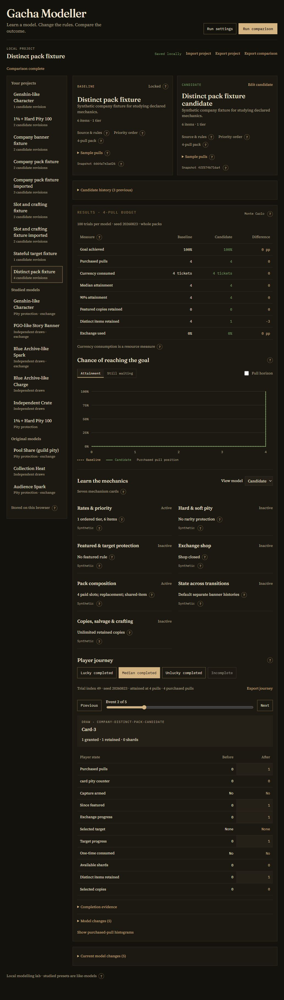
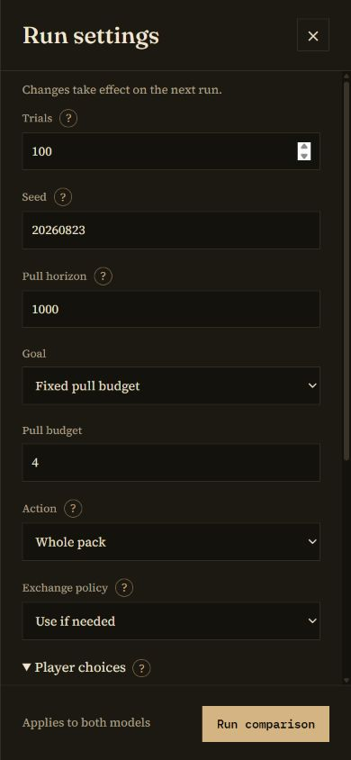

# Company workbench

Milestones 2, 3 and 4 provide a local authoring and comparison workflow. It compares mechanics and resource consumption. The later economy and evidence milestones cover company profitability, engagement and retention.

## First comparison

1. Open the lab at `http://localhost:3018/`.
2. Use **Import project** with [company-banner.json](fixtures/company-banner.json). Import creates a locked baseline and an editable candidate. The baseline keeps its source; candidate forks are labelled original.
3. Open **Edit candidate**, change **Chase hard pity** from 100 to 80, review the description/notes to match the new rule, then **Save candidate**. Invalid drafts cannot be saved. The previous candidate stays in history.
4. In **Run settings**, set 1,000 trials, seed 42 and a 200-pull horizon. Run the comparison.
5. Baseline mean purchases are 63.276 pulls; candidate mean purchases are 55.177. Both attain 100%; p90 changes from 100 to 80. These are sampled resource outcomes.
6. Switch between attainment and still-waiting curves. Both use the same axes and the whole population, including unfinished goals. **Completion evidence** explains failures and conditional summaries.
7. Export both project and comparison. Re-importing the comparison restores the exact snapshot pair and controls and reproduces the numerical reports.

Repeat with [company-pack.json](fixtures/company-pack.json), choose **Whole pack**, and change the cap to 80. The declared purchase has ten slots. At the same seed and trial count, mean purchased pulls are 66.32 versus 57.85; p90 attainment is 100 versus 80. Acquisition can occur before a pack's final slot, but the full purchase is charged. The filler minimum adds no extra chase guarantee.

## Authoring and help

The editor also supports selected-target/once-only rules, player-selected shops, counter persistence, explicit pack slots, duplicate transformations, crafting and individual rule sources. It supports item IDs, names, weights and featured flags; rarity priority and rates; hard/soft pity and reset links; featured probability and capture; charge checkpoints; exchange cost/reset effects; pack size/minimum tier; and the existing original modifiers. Probabilities use fractions, so `0.01` means 1%. Renaming a rarity updates references. Removing it may require fixing remaining items or rules; live validation identifies those fields.

The header has two fixed actions. Run controls live in a drawer with a scrolling body and fixed action footer, so more controls can be added without expanding the header. Short descriptions stay visible. Detailed explanations use custom `?` panels, available by hover, keyboard focus or tap. Escape dismisses the help first, then the drawer; drawer closure restores focus. Long panels scroll within the viewport. From a focused help button, Down Arrow moves focus into the panel so you can scroll with the keyboard; Escape returns to the trigger. The model library collapses on small screens and wide comparison tables scroll within their own container.

Candidate drafts stay in memory while their project remains selected. Save creates a new immutable revision. History loads an earlier revision into the editor for review and a new save; it never edits the baseline. Committed projects, settings and history save locally. Export regularly for portable backups. A failed local save is shown explicitly. Unreadable primary and backup copies are preserved, and the app works in memory rather than replacing them.

## Import and replay contract

Supported JSON inputs:

- Raw legacy `Banner` object.
- `gacha-modeller-model` versions 1 and 2. New M3 rules require version 2.
- `gacha-modeller-project` versions 1, 2 and 3 with schema-versioned snapshots, history and settings.
- M1 `gacha-modeller-result` version 1, restoring the model and original controls.
- M2/M3/M4 `gacha-modeller-comparison` versions 1, 2 and 3, restoring both models and completed-run settings. M3 exports include representative journeys; M4 exports add exact references, uncertainty and requested population/parameter analyses.

Snapshots hash canonical model content using SHA-256: object keys sorted, array order retained, absent optional fields omitted. Imports verify hashes and supported fields. This detects content mismatches; it does not authenticate the author. An import with an existing project ID creates a separate project. Comparison exports use the completed run's settings even when the settings drawer contains newer edits. Imports are limited to 5 MB.

M4 comparison exports use `analysis-4` / `event-streams-v1`; M3 exports used `mechanics-3`. Version 1 comparisons remain importable. For a programmatic replay, import `importProject` from `src/project/project.ts` and `compareProject` from `src/jobs/compare.ts`, then run:

```ts
const project = await importProject(bundle);
const replay = await compareProject(project, project.settings);
```

Trial/event indexing makes main comparison results independent of worker batch size. Older M1 numerical sequences use `runMonteCarlo` with their manifest. Supplementary guild and two-pickup lessons keep their legacy random policy and explicit scenario controls. They are separate lessons, not edited-candidate evaluations.

## Current limits

The [M4 guide](milestone-4.md) explains exact-solver limits, approximate simulation intervals, weighted player groups and bounded parameter experiments. Reachability diagnostics remain conservative. No-replacement and shared-item packs currently require an unprotected single-tier pool. Arbitrary slot correlations and batch discounts are not represented. There is no paid/free currency ledger or behavioural calibration yet. The [development checklist](../DEVELOPMENT.md) defines those next steps.

## Learn and replay a rule

Results contain seven mechanism cards for either immutable model. Each card describes the active rule and exposes its source class, reference, date and region through a help panel. Cited shape and synthetic are author declarations; the lab does not independently verify them. Review source overrides when modifying a cited rule.

Player journey selects actual lucky, median and unlucky completed trials near the completed subgroup's 5th, 50th and 95th attainment percentiles. **Incomplete** selects the first unfinished population member. These conditional illustrations do not replace the population curves. Previous/Next and the event slider show purchased draws, exchanges, crafting and transitions with before/after protection and resources.

**Export journey** saves a `gacha-modeller-journey` version 1 envelope. It contains the immutable initial model, goal, policies, scheduled destination models, seed, exact trial index, events and full final result. This diagnostic envelope is not a project import. Replay its trace from application code:

```ts
const t = bundle.trace;
const replay = traceTrial(t.model, t.goal, t.seed, t.trialIndex, t.sparkPolicy, t.options);
```

Import `traceTrial` from `src/engine/index.ts`. Comparisons store at most 200 events per journey and mark truncation; the final result still includes every action. The programmatic trace API accepts a limit up to 2,000 events.

## M3 fixtures

- [Stateful target fixture](fixtures/company-stateful.json): selected Alpha, one-time target protection, player-selected shop and explicit family/account scopes. Set named goals Alpha x2 and Beta x1, 100 trials, horizon 10, selected shop Beta, and a season transition after 4 pulls. At seed 20260823, 5% finish; trial 0 remains incomplete. Its season boundary resets target/shop progress while inventory stays owned.
- [Slot and crafting fixture](fixtures/company-slots.json): a three-slot pack grants four Common copies. Cap 1 retains one; three overflow copies earn six shards. Set **Whole pack**, named goal Rare x1 and **Craft missing goal items**. One purchase crafts the zero-weight Rare for six shards. Set candidate pack size 2 and craft cost 4: both sides finish, purchases change from 3 to 2, and shard balances reconcile to zero.
- [Distinct pack fixture](fixtures/company-distinct-pack.json): four weighted draws without replacement from six cards. Set whole packs and a four-pull budget. Change candidate sampling to replacement and correlation to shared item: both purchase four slots, while distinct items change from 4 to 1. The editor rejects shared-item plus no-replacement sampling.

Scheduled transitions use purchased-pull boundaries, defer events inside a pack until it ends, and resolve equal boundaries by array order. A banner destination is an embedded snapshot applied to both sides. All destination prices must use the same currency unit. See [M3 mechanics](milestone-3.md) for the delivery contract.





## Mathematical checks and parameter experiments

Read the [M4 guide](milestone-4.md) for the interval table and exact probabilities. Import [company-analysis.json](fixtures/company-analysis.json) to explore price/pity tradeoffs with a validation seed, or [company-cohorts.json](fixtures/company-cohorts.json) to compare fresh and returning players with explicit starting progress and shares. Controls live in Run settings. Each analysis keeps the fresh main comparison separate and exports the exact assumptions needed for replay.
